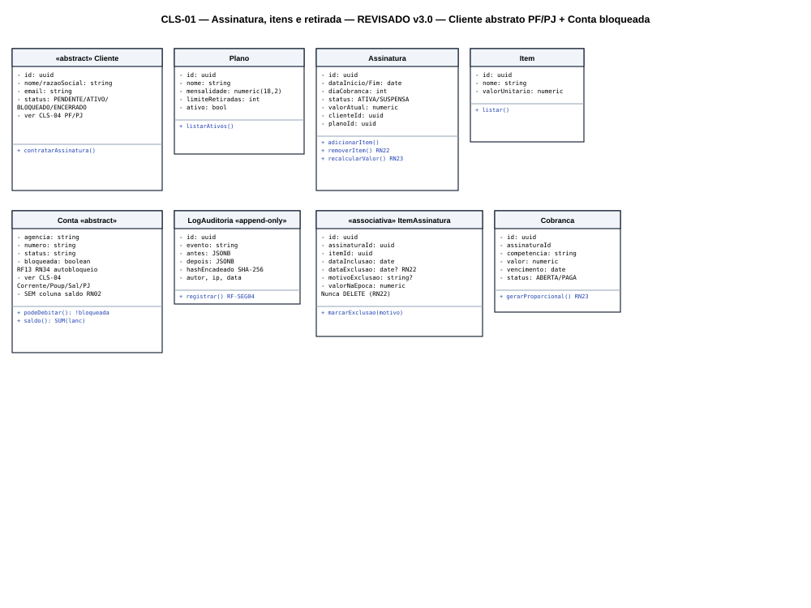
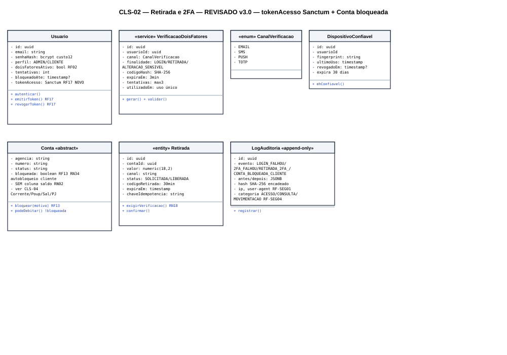
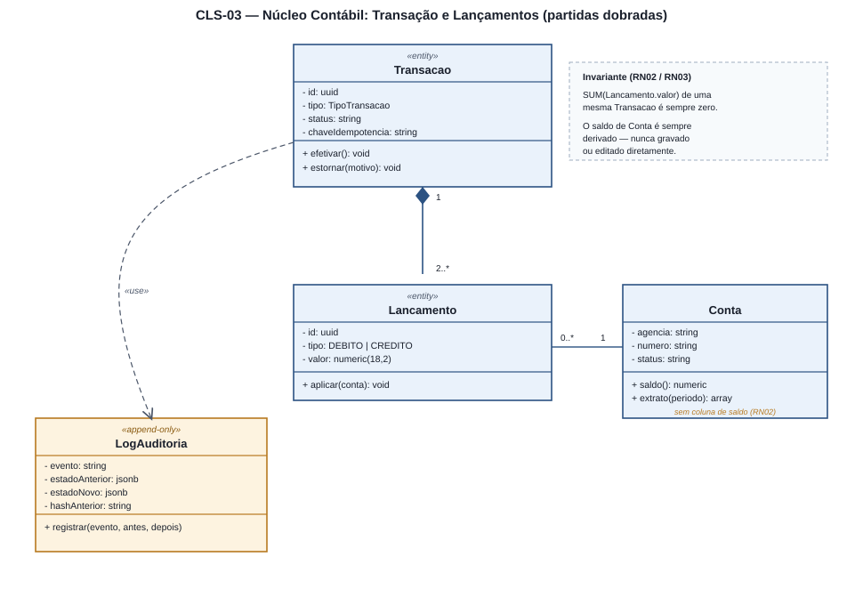
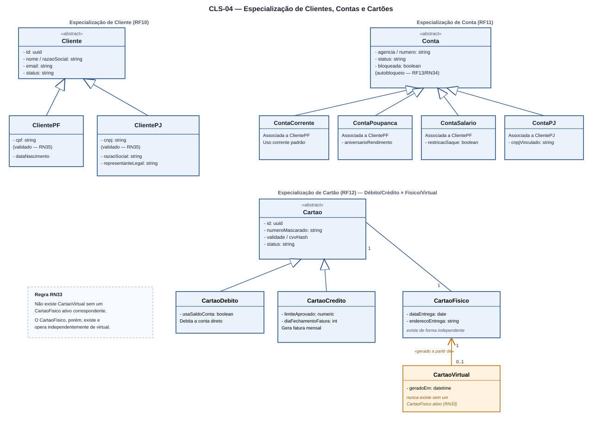
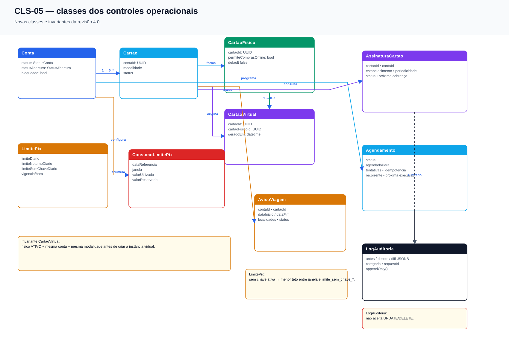
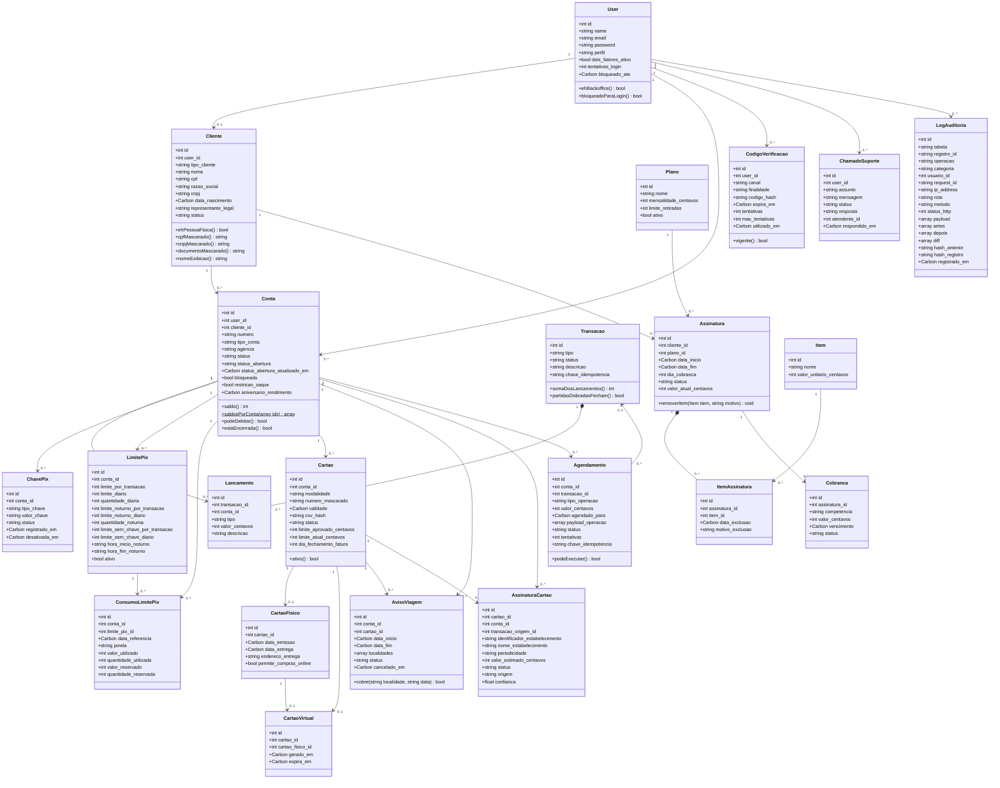

# 4.3 — Diagrama de Classes (UML)

## 1. Convenções

| Elemento | Notação |
|---|---|
| Atributo | `- nome: tipo` (privado) |
| Método | `+ nome(param): retorno` (público) |
| Composição / Agregação | Losango preenchido / vazio na ponta do todo |
| Generalização / Especialização | Seta com ponta triangular vazada, da subclasse para a superclasse |
| Dependência | Linha tracejada `«use»` |
| Estereótipos | `«entity»`, `«service»`, `«enum»`, `«abstract»`, `«associativa»`, `«append-only»` |

---

## 2. CLS-01 — Assinatura, itens contratados e retirada de itens



| Classe | Papel |
|---|---|
| `Cliente` `«abstract»` | `id`, `nome`, `email`, `status` (`PENDENTE`/`ATIVO`/`BLOQUEADO`/`ENCERRADO`) — **especializado em `ClientePF`/`ClientePJ`, ver CLS-04** *(revisão)* |
| `Plano` | Catálogo: `mensalidade`, `limiteRetiradas`, `ativo` |
| `Assinatura` | Vínculo cliente↔plano: `dataInicio/Fim`, `diaCobranca`, `status`, `valorAtual` |
| `Item` | Catálogo de itens contratáveis (`valorUnitario`) |
| `ItemAssinatura` `«associativa»` | **Onde a retirada de item acontece** — `dataExclusao`/`motivoExclusao` preenchidos, nunca `DELETE` (RN22) |
| `Cobranca` | Ciclo de faturamento: `competencia`, `valor`, `vencimento`, `status` |
| `LogAuditoria` `«append-only»` | Registra toda inclusão/retirada/troca/suspensão/cancelamento |

**Multiplicidades-chave:** `Cliente 1—0..*Assinatura` · `Assinatura 1◆—0..*ItemAssinatura` (composição) · `Assinatura 1—0..*Cobranca`

**RN22 (Laravel):**
```php
public function removerItem(Item $item, string $motivo): void
{
    $vinculo = $this->itensAtivos()->where('item_id', $item->id)->firstOrFail();
    $vinculo->update(['data_exclusao' => now()->toDateString(), 'motivo_exclusao' => $motivo]);
    $this->recalcularValor();
    $this->registrarAuditoria('ITEM_RETIRADO', $vinculo, $motivo);
}
```

---

## 3. CLS-02 — Retirada (saque) e Verificação em Dois Fatores



| Classe | Papel |
|---|---|
| `Usuario` | `senhaHash` (bcrypt custo 12), `perfil`, `doisFatoresAtivo`, `tentativas`/`bloqueadoAte`, `tokenAcesso` (Sanctum) *(revisão — RF17)* |
| `VerificacaoDoisFatores` `«service»` | Modela o desafio: `canal`, `finalidade` (`LOGIN`/`RETIRADA`/`ALTERACAO_SENSIVEL`), `codigoHash`, `expiraEm`, `tentativas`, `utilizadoEm` |
| `CanalVerificacao` `«enum»` | `EMAIL`, `SMS`, `PUSH`, `TOTP` |
| `DispositivoConfiavel` | Dispensa 2FA por 30 dias — `fingerprint`, `ultimoUso`, `revogadoEm` *(planejado para evolução futura)* |
| `Conta` `«abstract»` | `agencia`, `numero`, `status`, **`bloqueada: boolean`** (autobloqueio do cliente, RF13) — **sem coluna de saldo** (RN02) — **especializada em `ContaCorrente`/`ContaPoupanca`/`ContaSalario`/`ContaPJ`, ver CLS-04** *(revisão)* |
| `Retirada` `«entity»` | `valor`, `canal`, `status`, `codigoRetirada`, `expiraEm`, `chaveIdempotencia` *(modelada como `Transacao` de débito no backend v1)* |
| `LogAuditoria` `«append-only»` | Solicitação, desafio, falha, liberação, uso, cancelamento, estorno |

**Regra central RN18:**
```php
public function exigirVerificacao(): bool
{
    $teto = now()->between('20:00', '06:00') ? 500.00 : $this->conta->limite_retirada_diaria;
    return $this->valor > ($teto * 0.30)
        || $this->canalEhInedito()
        || ! $this->dispositivoEhConfiavel()
        || now()->between('20:00', '06:00');
}
```

**Bloqueio de conta pelo cliente (RN34, novo):**
```php
public function bloquear(string $motivo): void
{
    $this->update(['bloqueada' => true]);
    $this->registrarAuditoria('CONTA_BLOQUEADA_CLIENTE', $motivo);
}

public function podeDebitar(): bool
{
    return ! $this->bloqueada; // nenhum débito passa enquanto bloqueada
}
```

---

## 4. CLS-03 — Núcleo Contábil: Transação e Lançamentos (partidas dobradas)



O escopo define o core bancário como construído sob **partidas dobradas** (RF03, RN02, RN03) e o SEQ-03/ATV-02 já descrevem esse fluxo.

| Classe | Papel |
|---|---|
| `Transacao` `«entity»` | Cabeçalho de uma operação financeira: `tipo` (`PIX`, `TED_INTERNA`, `BOLETO`, `RETIRADA`, `ASSINATURA`), `status`, `chaveIdempotencia`, `criadoEm` |
| `Lancamento` `«entity»` | Uma linha de débito **ou** crédito ligada a uma `Transacao` e a uma `Conta`: `tipo` (`DEBITO`/`CREDITO`), `valor` `numeric(18,2)` |
| `Conta` `«abstract»` | Mesma classe do CLS-02 — o saldo é `SUM(lancamentos.valor)` filtrado pela conta; qualquer subtipo (CLS-04) participa igualmente |
| `LogAuditoria` `«append-only»` | Estado antes/depois de cada `Transacao` |

**Multiplicidades:** `Transacao 1◆—2..*Lancamento` (composição — lançamentos não existem sem a transação) · `Conta 1—0..*Lancamento`

**Invariante central (RN02/RN03):** a soma dos `Lancamento.valor` de uma `Transacao` é sempre zero; nenhum saldo é gravado ou editado diretamente.

```php
// app/Models/Transacao.php
public function efetivar(): void
{
    \DB::transaction(function () {
        $soma = $this->lancamentos()->sum('valor');
        if ($soma !== 0.0) {
            throw new PartidaDobradaInvalidaException(); // RN03
        }
        // RN27: valida saldo disponível antes de efetivar débitos
        $this->update(['status' => 'EFETIVADA']);
        $this->registrarAuditoria('TRANSACAO_EFETIVADA');
    });
}
```

---

## 5. CLS-04 — Especialização de Clientes, Contas e Cartões *(novo)*



Conforme definido na apresentação, três hierarquias de especialização foram detalhadas: **Cliente** (PF/PJ), **Conta** (Corrente/Poupança/Salário/PJ) e **Cartão** (Débito/Crédito, com instâncias Física e Virtual). A instância virtual é opcional, possui `contaId` por meio de `Cartao` e depende de um físico ativo da mesma modalidade.

### 5.1 Especialização de `Cliente` (RF10)

| Classe | Papel |
|---|---|
| `Cliente` `«abstract»` | Atributos comuns: `id`, `nome`/`razaoSocial`, `email`, `status` |
| `ClientePF` | `cpf: string` (validado matematicamente, RN35), `dataNascimento` |
| `ClientePJ` | `cnpj: string` (validado matematicamente, RN35), `razaoSocial: string`, `representanteLegal: string` |

### 5.2 Especialização de `Conta` (RF11)

| Classe | Papel |
|---|---|
| `Conta` `«abstract»` | Atributos comuns (ver CLS-02/03): `agencia`, `numero`, `status`, `bloqueada: boolean` |
| `ContaCorrente` | Associada a `ClientePF`; conta padrão de movimentação |
| `ContaPoupanca` | Associada a `ClientePF`; `aniversarioRendimento: date` |
| `ContaSalario` | Associada a `ClientePF`; `restricaoSaque: boolean` |
| `ContaPJ` | Associada a `ClientePJ`; `cnpjVinculado: string` |

### 5.3 Especialização de `Cartao` (RF12, RN33)

| Classe | Papel |
|---|---|
| `Cartao` `«abstract»` | Atributos comuns: `id`, `numeroMascarado`, `validade`, `cvvHash`, `status` |
| `CartaoDebito` | Extends `Cartao` — usa o saldo da conta diretamente |
| `CartaoCredito` | Extends `Cartao` — `limiteAprovado: numeric`, `diaFechamentoFatura: int` |
| `CartaoFisico` | Forma física de um `CartaoDebito`/`CartaoCredito` — `dataEntrega`, `enderecoEntrega`, `permiteComprasOnline`; é a origem do virtual |
| `CartaoVirtual` | Instância virtual com `cartaoId` próprio, `geradoEm` e `cartaoFisicoId`; **associação obrigatória com um `CartaoFisico` ativo da mesma conta/modalidade** (RN33) |

**Multiplicidades:** `Cartao 1—0..1 CartaoFisico` · `Cartao 1—0..1 CartaoVirtual` · `CartaoFisico 1—0..1 CartaoVirtual` (origem obrigatória do virtual). Em ambos os casos `Cartao.contaId` aponta para a conta titular.

**RN33 (Laravel):**
```php
// app/Services/CartoesService.php (transação única)
public function gerarVirtual(Cartao $cartaoFisico): Cartao
{
    $cartaoFisico->loadMissing('fisico', 'virtual');

    if (! $cartaoFisico->fisico) {
        throw new RegraDeNegocioException('O cartão informado não é um cartão físico.', 422);
    }

    if ($cartaoFisico->status !== Cartao::STATUS_ATIVO) {
        throw new CartaoFisicoInativoException();
    }

    if ($cartaoFisico->fisico->cartaoVirtual()->exists() || $cartaoFisico->virtual()->exists()) {
        throw new ConflitoDeNegocioException('Já existe um cartão virtual vinculado a este cartão físico.');
    }

    return DB::transaction(function () use ($cartaoFisico): Cartao {
        $cartaoVirtual = Cartao::create([
            'conta_id' => $cartaoFisico->conta_id,
            'modalidade' => $cartaoFisico->modalidade,
            'numero_mascarado' => $this->gerarPanMascarado(),
            'validade' => now()->addYear()->endOfMonth()->toDateString(),
            'cvv_hash' => Hash::make((string) random_int(100, 999)),
            'status' => Cartao::STATUS_ATIVO,
            'limite_aprovado_centavos' => $cartaoFisico->limite_aprovado_centavos,
            'limite_atual_centavos' => $cartaoFisico->limite_atual_centavos,
            'dia_fechamento_fatura' => $cartaoFisico->dia_fechamento_fatura,
        ]);

        CartaoVirtual::create([
            'cartao_id' => $cartaoVirtual->id,
            'cartao_fisico_id' => $cartaoFisico->fisico->id,
            'gerado_em' => now(),
            'expira_em' => now()->addYear(),
        ]);

        return $cartaoVirtual->load('virtual');
    });
}
```

---

## 6. CLS-05 — Controles operacionais da revisão 4.0



| Classe | Atributos/relacionamentos | Responsabilidade |
|---|---|---|
| `Conta` | `status`, `statusAbertura`, `statusAberturaAtualizadoEm` | Separa ciclo operacional do KYC; `ATIVA` só após aprovação. |
| `Cartao` | `conta`, `modalidade`, `status` | Uma instância lógica por cartão físico ou virtual. |
| `CartaoFisico` | `permiteComprasOnline: boolean` | Flag de autorização de compras on-line, default `false`. |
| `CartaoVirtual` | `cartao`, `cartaoFisico` | Instância própria ligada à mesma conta e ao físico de origem. |
| `LimitePix` | Limites diurno/noturno e `limiteSemChave*` | Política vigente por conta. |
| `ConsumoLimitePix` | `dataReferencia`, `janela`, usado/reservado | Controle atômico por dia e horário. |
| `AvisoViagem` | `conta`, `cartao`, período, localidades, status | Neutraliza divergência de localização só para o cartão vinculado. |
| `AssinaturaCartao` | `cartao`, `conta`, estabelecimento, periodicidade, status | Read model de assinaturas recorrentes detectadas no cartão. |
| `Agendamento` | `agendadoPara`, `status`, tentativas, idempotência | Fila persistida para execução futura/recorrente. |
| `LogAuditoria` | `antes`, `depois`, `diff`, hashes | Trilha append-only de alterações e consultas. |

**Invariantes da classe `CartaoVirtual`:** o serviço de emissão abre a transação, valida físico ativo + mesma modalidade + mesma conta e cria a instância virtual. O banco garante os FKs; a regra de equivalência entre conta/modalidade fica no serviço e é auditada.

**Invariantes da classe `LimitePix`:** na ausência de chave Pix ativa, o teto aplicável é o menor entre o limite da janela e `limiteSemChave*`. O consumo é reservado antes do risco e convertido em uso somente após a efetivação.

**Invariantes da classe `Agendamento`:** um worker só captura `AGENDADO`; `chaveIdempotencia` é reutilizada na `Transacao` para impedir execução duplicada.

---

## 7. CLS-06 — Arquitetura Real do Backend: Interações entre Controllers, Services e Support *(revisão 5.0)*

O diagrama abaixo representa fielmente as classes implementadas em `Projeto/backend/app/Http/Controllers`, `Projeto/backend/app/Services` e `Projeto/backend/app/Support`, evidenciando as interações por injeção de dependência e chamadas estáticas entre as camadas da API REST v1 (fonte em `fontes/cls-06-interacoes-backend-mvc.mmd`):

```mermaid
classDiagram
    direction TB

    class CadastroController {
        -CadastroService cadastro
        +store(Request request) JsonResponse
    }
    class AuthController {
        -AuthService auth
        -Servico2FA doisFatores
        +login(Request request) JsonResponse
        +validarDoisFatores(Request request) JsonResponse
        +novoDesafio(Request request) JsonResponse
        +ativarDoisFatores(Request request) JsonResponse
        +desativarDoisFatores(Request request) JsonResponse
        +refresh(Request request) JsonResponse
        +logout(Request request) JsonResponse
        +logoutTodos(Request request) JsonResponse
        +eu(Request request) JsonResponse
    }
    class ContaController {
        -ContaService contas
        -RelatorioService relatorios
        -LimitePixService limites
        +show(Request request) JsonResponse
        +extrato(Request request) JsonResponse
        +extratoCategorizado(Request request) JsonResponse
        +bloquear(Request request) JsonResponse
        +desbloquear(Request request) JsonResponse
        +encerrar(Request request) JsonResponse
    }
    class TransacaoController {
        -TransferenciaService transferencias
        +store(Request request) JsonResponse
        +show(Request request, Transacao transacao) JsonResponse
        +index(Request request) JsonResponse
    }
    class ChavePixController {
        -ChavePixService chaves
        +index(Request request) JsonResponse
        +store(Request request) JsonResponse
        +destroy(Request request, ChavePix chave) JsonResponse
    }
    class PixController {
        -PagamentosService pagamentos
        -LimitePixService limites
        -ContaService contas
        +cobranca(Request request) JsonResponse
        +receber(Request request) JsonResponse
        +limites(Request request) JsonResponse
    }
    class BoletoController {
        -PagamentosService pagamentos
        +pagar(Request request) JsonResponse
        +validar(Request request) JsonResponse
    }
    class CartaoController {
        -CartoesService cartoes
        +index(Request request) JsonResponse
        +store(Request request) JsonResponse
        +gerarVirtual(Request request, Cartao cartao) JsonResponse
        +bloqueio(Request request, Cartao cartao) JsonResponse
        +limite(Request request, Cartao cartao) JsonResponse
        +comprasOnline(Request request, Cartao cartao) JsonResponse
    }
    class AvisoViagemController {
        -AvisoViagemService avisos
        +index(Request request) JsonResponse
        +store(Request request) JsonResponse
        +cancelar(Request request, AvisoViagem aviso) JsonResponse
    }
    class AgendamentoController {
        -AgendamentoService agendamentos
        +index(Request request) JsonResponse
        +store(Request request) JsonResponse
        +cancelar(Request request, Agendamento agendamento) JsonResponse
    }
    class AssinaturaController {
        -AssinaturaService assinaturas
        +planos() JsonResponse
        +index(Request request) JsonResponse
        +store(Request request) JsonResponse
        +adicionarItem(Request request, Assinatura assinatura) JsonResponse
        +removerItem(Request request, Assinatura assinatura, Item item) JsonResponse
        +cancelar(Request request, Assinatura assinatura) JsonResponse
    }
    class AssinaturaCartaoController {
        +index(Request request) JsonResponse
        +cancelar(Request request, AssinaturaCartao assinaturaCartao) JsonResponse
    }
    class ChamadoSuporteController {
        +index(Request request) JsonResponse
        +store(Request request) JsonResponse
        +show(Request request, ChamadoSuporte chamado) JsonResponse
    }
    class BackofficeController {
        -ContaService contas
        +resumo() JsonResponse
        +contas(Request request) JsonResponse
        +aprovarKyc(Conta conta) JsonResponse
        +recusarKyc(Request request, Conta conta) JsonResponse
        +bloquearPorFraude(Request request, Conta conta) JsonResponse
        +chamados() JsonResponse
        +responderChamado(Request request, ChamadoSuporte chamado) JsonResponse
    }
    class AuditoriaController {
        +index(Request request) JsonResponse
        +show(LogAuditoria log) JsonResponse
    }
    class HealthController {
        +__invoke() JsonResponse
    }

    class CadastroService {
        +cadastrarPessoaFisica(array dados) Conta
        +cadastrarPessoaJuridica(array dados) Conta
        +abrirConta(User user, Cliente cliente, string tipoConta) Conta
    }
    class AuthService {
        -AuditoriaService auditoria
        -Servico2FA doisFatores
        +login(string email, string senha) array
        +validarSegundoFator(User user, string codigo) array
        +refresh(User user) array
        +logout(User user) void
        +ativarDoisFatores(User user) void
        +desativarDoisFatores(User user) void
    }
    class Servico2FA {
        +gerar(User user, string finalidade) array
        +validar(User user, string codigo, string finalidade) CodigoVerificacao
    }
    class ContaService {
        +saldo(Conta conta) int
        +extrato(Conta conta, int porPagina) LengthAwarePaginator
        +bloquear(Conta conta, string motivo) Conta
        +desbloquear(Conta conta) Conta
        +encerrar(Conta conta) Conta
        +aprovarAbertura(Conta conta) Conta
        +recusarAbertura(Conta conta, string motivo) Conta
        +bloquearPorFraude(Conta conta, string motivo) Conta
        +resumoDoDia(Conta conta) array
    }
    class TransferenciaService {
        -LancamentoService lancamentos
        -MotorAntifraude antifraude
        -LimitePixService limites
        -ChavePixService chaves
        +transferir(Conta origem, Conta destino, int valorCentavos, string descricao, string tipo, string chaveIdempotencia) Transacao
        +transferirPorChavePix(Conta origem, string chaveValor, int valorCentavos, string descricao, string chaveIdempotencia) Transacao
        +estornar(Transacao transacao, Conta contaOrigem, Conta contaDestino) Transacao
    }
    class LancamentoService {
        +lancar(string tipo, array linhas, string descricao, string chaveIdempotencia, string status) Transacao
        +transferir(Conta origem, Conta destino, int valorCentavos, string descricao, string tipo, string chaveIdempotencia) Transacao
        +creditar(Conta conta, int valorCentavos, string tipo, string descricao, string chaveIdempotencia) Transacao
        +debitar(Conta conta, int valorCentavos, string tipo, string descricao, string chaveIdempotencia) Transacao
    }
    class MotorAntifraude {
        -LimitePixService limites
        +analisar(Conta origem, Conta destino, int valorCentavos, string tipo) array
    }
    class LimitePixService {
        +politica(Conta conta) array
        +janela(array politica, Carbon momento) string
        +verificar(Conta conta, int valorCentavos) array
        +reservar(Conta conta, int valorCentavos) ConsumoLimitePix
        +consumirReservado(ConsumoLimitePix consumo, int valorCentavos) ConsumoLimitePix
        +consumir(ConsumoLimitePix consumo, int valorCentavos) void
        +devolverReserva(ConsumoLimitePix consumo, int valorCentavos) void
        +confirmar(ConsumoLimitePix consumo, int valorCentavos) void
        +consumoDoDia(Conta conta, string janela) ConsumoLimitePix
        +resumo(Conta conta) array
    }
    class ChavePixService {
        +cadastrar(Conta conta, string tipo, string valor) ChavePix
        +revogar(ChavePix chave) ChavePix
        +resolver(string valor) ChavePix
    }
    class PagamentosService {
        -LancamentoService lancamentos
        -MotorAntifraude antifraude
        -LimitePixService limites
        +pagarBoleto(Conta conta, string linhaDigitavel, int valorCentavos, string chaveIdempotencia) Transacao
        +gerarCobrancaPix(Conta conta, int valorCentavos, string descricao) array
        +receberPix(Conta conta, int valorCentavos, string descricao, string chaveIdempotencia) Transacao
        +depositar(Conta conta, int valorCentavos, string descricao) Transacao
    }
    class CartoesService {
        +emitirFisico(Conta conta, string modalidade, string enderecoEntrega) Cartao
        +gerarVirtual(Cartao cartaoFisico) Cartao
        +bloqueio(Cartao cartao, bool bloquear) Cartao
        +ajustarLimite(Cartao cartao, int novoLimiteCentavos) Cartao
        +definirComprasOnline(Cartao cartao, bool permitir) CartaoFisico
    }
    class AvisoViagemService {
        +criar(Conta conta, Cartao cartao, array localidades, string inicio, string fim) AvisoViagem
        +cancelar(AvisoViagem aviso) AvisoViagem
        +existeAvisoAtivo(Cartao cartao, string localidade) bool
    }
    class AgendamentoService {
        -TransferenciaService transferencias
        +agendar(Conta origem, Conta destino, int valorCentavos, Carbon quando, string descricao, string tipo, string chaveIdempotencia) Agendamento
        +cancelar(Agendamento agendamento, Conta conta) Agendamento
        +executar(Agendamento agendamento) string
        +expirarAntigos() int
    }
    class AssinaturaService {
        +contratar(Cliente cliente, Plano plano, int diaCobranca) Assinatura
        +adicionarItem(Assinatura assinatura, Item item) ItemAssinatura
        +removerItem(Assinatura assinatura, Item item, string motivo) void
        +cancelar(Assinatura assinatura) Assinatura
        +gerarCobrancaProporcional(Assinatura assinatura) Cobranca
    }
    class RelatorioService {
        +comprovante(Transacao transacao) array
        +extratoCategorizado(Conta conta, Carbon de, Carbon ate) array
    }
    class AuditoriaService {
        +registrar(string categoria, string operacao, array payload, string tabela, string registroId, int usuarioId, Request request, int statusHttp) LogAuditoria
        +categoriaDaRequisicao(Request request) string
        +requestId(Request request) string
    }

    class ContaInterna {
        +obter()$ Conta
    }
    class Emv {
        +pixPayload(string chave, int valorCentavos, string txid, string nome, string cidade)$ string
        +crc16(string payload)$ string
    }
    class Sanitizador {
        +limpar(mixed dado)$ mixed
        +cabecalhos(array headers)$ array
    }

    CadastroController --> CadastroService
    AuthController --> AuthService
    AuthController --> Servico2FA
    ContaController --> ContaService
    ContaController --> RelatorioService
    ContaController --> LimitePixService
    TransacaoController --> TransferenciaService
    TransacaoController ..> RelatorioService
    ChavePixController --> ChavePixService
    PixController --> PagamentosService
    PixController --> LimitePixService
    PixController --> ContaService
    BoletoController --> PagamentosService
    CartaoController --> CartoesService
    AvisoViagemController --> AvisoViagemService
    AgendamentoController --> AgendamentoService
    AssinaturaController --> AssinaturaService
    BackofficeController --> ContaService

    AuthService --> AuditoriaService
    AuthService --> Servico2FA
    TransferenciaService --> LancamentoService
    TransferenciaService --> MotorAntifraude
    TransferenciaService --> LimitePixService
    TransferenciaService --> ChavePixService
    TransferenciaService ..> AuditoriaService
    MotorAntifraude --> LimitePixService
    PagamentosService --> LancamentoService
    PagamentosService --> MotorAntifraude
    PagamentosService --> LimitePixService
    PagamentosService ..> Emv
    PagamentosService ..> AuditoriaService
    LancamentoService ..> ContaInterna
    AgendamentoService --> TransferenciaService
    AgendamentoService ..> AuditoriaService
    CartoesService ..> AuditoriaService
    ChavePixService ..> AuditoriaService
    ContaService ..> AuditoriaService
    CadastroService ..> AuditoriaService
    AuditoriaService ..> Sanitizador
```



---

## 8. CLS-07 — Modelos Eloquent Implementados (`app/Models`) *(revisão 5.0)*

O diagrama abaixo consolida as 22 classes Eloquent realmente implementadas em `Projeto/backend/app/Models`, com uso de *Single Table Inheritance* (STI) por coluna discriminadora em `Cliente` (`tipo_cliente`), `Conta` (`tipo_conta`) e `Cartao` (`modalidade`), além das tabelas especializadas `CartaoFisico` e `CartaoVirtual` (fonte em `fontes/cls-07-modelos-eloquent-reais.mmd`):



---

## 9. Mapeamento classes → tabelas (Implementação Real)

| Classe Conceitual (UML) | Classe Eloquent (`app/Models`) | Tabela (`PostgreSQL`) | Observação |
|---|---|---|---|
| `Cliente` / `ClientePF` / `ClientePJ` | `Cliente` | `clientes` (`tipo_cliente` discriminador) | Single Table Inheritance (`PF`, `PJ`) |
| `Usuario` | `User` | `users` | 1:1 com `Cliente`, 1:N com `Conta` |
| `Conta` / `ContaCorrente` / `ContaPoupanca` / `ContaSalario` / `ContaPJ` | `Conta` | `contas` (`tipo_conta` discriminador) | Sem coluna de saldo; `bloqueada: boolean` |
| `Transacao` / `Lancamento` | `Transacao` / `Lancamento` | `transacoes` / `lancamentos` | Núcleo de partidas dobradas (`valor_centavos`) |
| `VerificacaoDoisFatores` | `CodigoVerificacao` + `Servico2FA` | `codigos_verificacao` | Hash + expiração + tentativas |
| `Cartao` / `CartaoDebito` / `CartaoCredito` | `Cartao` | `cartoes` (`modalidade` discriminador) | Single Table Inheritance (`DEBITO`, `CREDITO`) |
| `CartaoFisico` / `CartaoVirtual` | `CartaoFisico` / `CartaoVirtual` | `cartoes_fisicos` / `cartoes_virtuais` | `cartoes_virtuais.cartao_fisico_id` obrigatório (RN33) |
| `Plano` / `Assinatura` / `Item` / `ItemAssinatura` / `Cobranca` | `Plano`, `Assinatura`, `Item`, `ItemAssinatura`, `Cobranca` | `planos`, `assinaturas`, `itens`, `itens_assinatura`, `cobrancas` | `itens_assinatura` sem exclusão física (RN22) |
| `LogAuditoria` | `LogAuditoria` | `logs_auditoria` | Append-only, com trigger PostgreSQL de bloqueio de `UPDATE`/`DELETE` |
| `LimitePix` / `ConsumoLimitePix` | `LimitePix` / `ConsumoLimitePix` | `limites_pix` / `consumos_limites_pix` | Política e consumo por dia/janela; inclui limite sem chave |
| `ChavePix` | `ChavePix` | `chaves_pix` | Chaves `CPF`, `CNPJ`, `EMAIL`, `TELEFONE`, `ALEATORIA` |
| `AvisoViagem` | `AvisoViagem` | `avisos_viagem` | FK obrigatória para `cartoes` e `contas` |
| `AssinaturaCartao` | `AssinaturaCartao` | `assinaturas_cartao` | Read model de recorrências detectadas no cartão |
| `Agendamento` | `Agendamento` | `agendamentos` | Status, tentativas, idempotência e execução futura |
| `ChamadoSuporte` | `ChamadoSuporte` | `chamados_suporte` | Atendimento e resposta do backoffice |

---

## 10. Rastreabilidade

| Requisito | Classe / diagrama |
|---|---|
| RF02, RF17 (2FA, token) | `CodigoVerificacao`, `Servico2FA`, `AuthService`, `User` (CLS-02, CLS-06, CLS-07) |
| RF07 (retirada / débito) | `LancamentoService::debitar()`, `Transacao`, `Conta` (CLS-02, CLS-06) |
| Módulo de Assinaturas (Escopo 4.1) | `Assinatura`, `Plano`, `Item`, `ItemAssinatura`, `Cobranca`, `AssinaturaService` (CLS-01, CLS-06, CLS-07) |
| RF03, RN02, RN03 (partidas dobradas) | `Transacao`, `Lancamento`, `LancamentoService`, `TransferenciaService` (CLS-03, CLS-06, CLS-07) |
| RN21–RN25 | `Assinatura`, `ItemAssinatura`, `Cobranca`, `AssinaturaService` |
| RF10, RN35 (clientes PF/PJ) | `Cliente`, `CadastroService`, `Cpf`, `Cnpj` (CLS-04, CLS-06, CLS-07) |
| RF11 (contas especializadas) | `Conta`, `ContaService` (CLS-04, CLS-06, CLS-07) |
| RF12, RN33 (cartões especializados) | `Cartao`, `CartaoFisico`, `CartaoVirtual`, `CartoesService` (CLS-04, CLS-06, CLS-07) |
| RF13, RN34 (bloqueio de conta) | `Conta::podeDebitar()`, `ContaService::bloquear()` (CLS-02, CLS-06, CLS-07) |
| RF-SEG01–04 | `LogAuditoria`, `AuditoriaService`, `AuditoriaRequisicao` (CLS-01, CLS-05, CLS-06, CLS-07) |

**Registro de alterações**

| Versão | Data | Alteração |
|---|---|---|
| 1.0 | 31/08/2026 | Versão inicial: CLS-01 e CLS-02 |
| 2.0 | 10/09/2026 | Texto condensado; CLS-03 — Núcleo Contábil adicionado |
| 3.0 | 10/09/2026 | **CLS-04 — Especialização de Clientes, Contas e Cartões** adicionado; CLS-01/02 ajustados para apontar à nova especialização; `Conta.bloqueada` e `Usuario.tokenAcesso` adicionados |
| 4.0 | 08/10/2026 | **CLS-05 — Controles operacionais** adicionado: status da conta, flag on-line, limites Pix, aviso por cartão, consulta de assinaturas do cartão, auditoria e agendamento |
| 5.0 | 28/10/2026 | **CLS-06 — Interações entre Controllers, Services e Support** e **CLS-07 — Modelos Eloquent Implementados** adicionados em Mermaid, alinhando a documentação 100% ao código-fonte do Checkpoint 3 |
